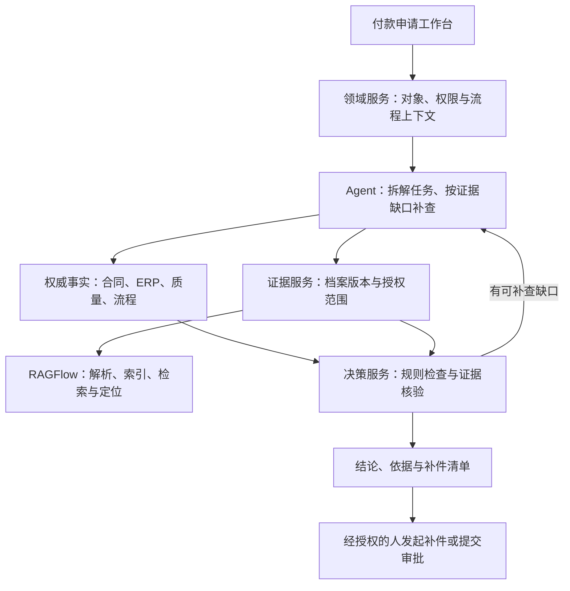

# 面向领域业务的 RAGFlow Agentic RAG 总体概要设计

**建议采用「业务系统保有事实与流程、领域服务提供决策上下文、RAGFlow 提供文档证据」的架构。** 以付款申请明细和合同付款里程碑为业务入口。Agent 可以拆解任务、选择工具、按缺口补查并解释结果。能否提交审批由版本化规则和权威事实共同判定，审批与支付由现有流程和财务系统执行。

首期范围为一个项目的一类设备、一个「验收后付款」里程碑和一条既有审批流程。以下对象编号、条款和条件为设计示例，实际规则由合同、质量与财务负责人确认。能力基线为本地 RAGFlow `main` 提交 `3facaf2f1`，仓库版本线为 0.26.3。

# 一 总体架构与责任边界

- **业务系统**维护合同、收货、验收、付款及审批的正式记录。现有 BPM 或 ERP 保有流程实例、办理人、审批结果和状态变更；档案系统保有原文、签署状态、版本及访问权限。

- **领域服务**提供统一对象 ID、对象关系、各字段的权威来源、规则版本和证据要求。首期可作为一个业务服务内的模块，关联表用现有关系库，沿用已有规则或审批服务。跨对象路径查询成为明确需求后，再考虑图存储。

- **Agent**在授权对象和工具范围内查证。每轮根据结构化缺口决定查合同版本、调业务 API、取已登记材料或检索原文。达到轮数或时间预算、有权威冲突、关键数据不可用时，返回相应状态并交业务人员处理。

- **RAGFlow**把授权文档转为可检索片段并返回定位信息。准备审批判定时，先通过领域和档案服务限定对象及文档版本，再检索正文。证据服务对返回文档再次校验，合格片段才进入 Agent 上下文。

# 二 业务对象与领域本体

先建立小范围的本体，由采购、质量、财务和档案人员共同确认。登记对象类型、主键、关系及基数、状态和适用范围，为每组关键字段绑定来源。例如「已到货」「质量验收通过」「已取得签署验收单」「符合送审条件」分别是收货事实、质量状态、证据状态和决策结果。

| 对象 | 核心属性与关联 | 权威来源示例 |
|---|---|---|
| 合同、合同版本、条款 | 合同有多个版本；条款含编号、适用对象、生效区间和修订关系。付款里程碑绑定适用条款 | 合同系统与签署件 |
| 付款里程碑 | 所属合同、期次、适用范围、金额或比例、所需验收范围 | 合同系统，财务确认口径 |
| 设备、收货明细、验收批 | 设备按项目及设备主键识别，序列号供核对；验收批通过明细关联多台设备和收货行 | ERP 收货、质量系统 |
| 验收记录 | 所属验收批、质量结论、时间、验收人；绑定正式验收报告及其版本 | 质量系统、档案系统 |
| 付款申请与明细 | 一单多行，每行绑定一个里程碑，通过分摊明细关联一个或多个验收批。分摊记录数量和金额，用于核对部分验收及重复计付 | ERP 或财务系统 |
| 流程实例、任务、事件 | 实例关联申请 ID；任务有节点、办理角色和状态；收货、签署、补件等事件可关联多个业务对象 | BPM、业务系统事件 |
| 规则版本、证据要求、证据引用 | 规则绑定适用条款和生效条件；证据要求绑定节点及对象，引用连接档案版本和原文位置 | 领域服务、档案系统 |

对象采用内部稳定 ID，另存来源系统与来源主键。首先按标识绑定，编号同名或映射不确定时交责任人确认。合同条款、规则和文档版本均保留生效时间与替代关系。历史复核按申请当时的适用事件和版本重放，同一事实保留来源、观测时间和可用的来源版本。

# 三 流程与规则设计

业务链路为 **收货登记 → 质量验收 → 签署归档 → 付款申请预核 → 人工审批 → 财务执行**。上述环节可由不同系统分别承接。付款申请进入「预核」时，从流程实例取得已办事项、当前任务和办理角色。预核结果附于申请或工作台，补齐材料后触发复核。生产上线前由业务方确认退回、重开和例外审批的路径。

以 `C-17 / M2` 为例，假设生效的补充协议第 4 条要求覆盖本次申请范围的签署版验收报告。规则版本 `M2-v2` 在本例按发起预核时的适用口径匹配合同和里程碑，记录每项条件及其所用证据。

| 规则检查 | 输入与判断 |
|---|---|
| 适用性 | 按合同范围、付款期次、约定的适用事件及时间选择条款与规则；口径冲突交合同负责人 |
| 到货与验收范围 | 对齐本次申请所覆盖的收货行、设备序列号或数量和验收批；通过结果须覆盖所申请范围 |
| 正式材料 | 核验档案版本、签署状态、验收批绑定及可追溯位置。验收草稿只能用于查阅和补件提示 |
| 金额与重复申请 | 按财务口径核对该里程碑应付和可申请余额，检查累计已付及有效在途占用；用业务服务计算金额 |
| 送审资格 | 所有适用的必需条件满足时输出「可提交审批」；多行申请按流程规则汇总各行结果 |

规则服务按项返回「满足」「明确不满足」「证据缺失」「来源不可用」「冲突」或「不适用」。预核记录完整的明细结果，可补充的缺件进入补件分支，冲突或无法核实的事实进入人工核验，明确违反门槛的申请保留阻断原因。证据充分性由适用规则和材料清单判定，检索分数只用于排序。规则表可用现有决策服务或版本化代码表达，规则与例外增多后再评估 DMN。

# 四 文档组织与证据链

1. **实行归档与索引分工。** 文件先在档案系统形成稳定的文档 ID、版本 ID、签署状态和访问权限。通过带用途的关联表，把一个文件版本绑定到多个业务对象或流程节点，例如「证明 B-03 验收」或「修订 C-17 的 M2 条款」。索引登记 `档案版本 ID ↔ RAGFlow dataset_id + document_id`，保存同步和解析状态。

2. **按材料类型配置解析。** 合同按条款结构保留标题、编号和上下文，扫描件用 DeepDoc 等支持的解析方式提取正文和表格，验收清单以可追溯的表格行或设备明细为单位。文档元数据可记录项目、类型、业务编号和归档版本。自动抽取字段先作为候选，经源系统校验或人工确认后，再用于正式绑定。

3. **先定授权范围，再查内容。** 证据服务取当前用户有权访问且适用于本次判断的档案版本，映射到 RAGFlow 文档 ID，再用「签署要求」「第 4 条」「设备编号」等定向查询做混合检索和可选重排。可检索集合为空时直接返回缺口或受限状态，禁止扩大为整个知识库查询。正式证据链使用普通检索，关闭知识图谱增强。原文打开与下载由档案系统重新鉴权。

4. **把引用固定到原文版本。** 审批记录保存证据要求 ID、档案版本 ID、原文件哈希、页码或表格行及必要的摘录，并登记当次 RAGFlow chunk ID 和定位字段。原文版本是长期锚点，重解析后的 chunk ID 可变化。签署、作废或权限变更先使相关的当前结果失效，随后同步或清理索引。历史决策保留当次使用的档案版本，阅览时按当前权限校验。缺少可靠原文定位时转人工核验。档案确实缺件、索引未同步、调用失败和权限受限分别记录，向用户展示其有权了解的状态。

# 五 单次预核如何运行

以付款申请 `P-204` 的第一行为例，关联合同 `C-17`、第二期里程碑 `M2` 和验收批 `B-03`。

1. **取得任务上下文。** 工作台传入申请 ID，领域服务以办理人身份校验访问范围，解析申请行和对象关系，查询现有流程实例。根据合同范围与适用时间确定 `M2-v2`，生成必须核对的事实和证据清单。

2. **并行获取权威事实。** ERP 返回对应设备已到货及财务占用信息，质量系统返回检验通过。档案服务返回验收报告 `D-451` 的草稿版本。Agent 定向检索已授权的补充协议，定位第 4 条，并按「正式签署件」的要求再次查询档案登记。

3. **给出可办理的结果。** 若档案系统确认尚未归档正式签署件，决策服务输出「待补签署版验收报告」。工作台展示对应条款、已满足条件、缺失材料和待办岗位。系统本身查不到档案状态时，结果为「待核验」，保留重试或人工处理路径。

4. **补件后重算。** 质量岗位提交签署件并完成归档，系统校验其版本、设备范围和签署状态。预核重新读取当前流程、金额占用和其他关键事实；全部满足时返回「可提交审批」，附规则版本与证据包。正式提交由授权人员发起，业务服务在写入前重检状态，使用流程版本和幂等键处理并发及重复提交。

工具接口建议围绕任务设计，例如 `get_payment_context`、`list_required_evidence`、`search_authorized_evidence`、`evaluate_payment_readiness`。办理人身份和授权范围由服务端从会话取得。预核记录包含业务对象与流程实例、事实来源、规则版本、证据版本、各条件结果和调用时间；Agent 输出使用该结果生成解读。工具结果及文档正文按数据处理，执行权限来自流程与服务端策略。

# 六 RAGFlow 复用与补建清单

| 能力 | 本地 RAGFlow 可复用 | 需要补建或集成 |
|---|---|---|
| 文档入库与解析 | Dataset、文档上传、DeepDoc PDF 解析、OCR、版面及表格处理、切片 | 档案版本映射、签署核验、对象挂接、生命周期同步；用典型合同及扫描验收单实测定位与表格质量 |
| 定向查找与引用 | 关键词与向量混合检索、可选重排、文档元数据、按文档 ID 限定、切片与位置字段 | 授权文档集合、元数据与 ID 的业务交集、原文锚点、引用核验；项目、对象和档案权限由业务侧强制执行 |
| Agent 编排 | Agent 与 Retrieval 组件、Switch、Iteration、HTTP 调用、MCP 客户端，可用于只读原型和解释 | 领域工具契约、来源校验、证据充分性判定、执行预算、可恢复状态和审计。可把多轮预核留在可测试的领域编排中 |
| 图谱探索 | 可配置实体类型，抽取关系，可选实体归并和社区报告 | 正式对象 ID、关系基数、有效期、来源与权限。业务关系来自权威数据和人工确认，文档抽取作为线索 |
| 规则与审批 | Agent 通过 HTTP 或 MCP 读取决策结果和待办 | 复用 ERP、QMS、BPM、档案和现有规则服务；补建适配、规则版本、证据清单与审计。实际审批、异常授权和支付由现有系统承接 |

**两个接入约束直接来自当前代码。** `POST /api/v1/retrieval` 在收到非空 `document_ids` 时走文档 ID 路径，`metadata_condition` 不会再替业务侧计算交集。启用 `use_kg` 时追加的知识图谱结果按知识库查询，该调用未传入文档 ID 白名单。因此审批链应由服务端先求交集，传入非空白名单，关闭 `use_kg` 并复核返回文档。页码或坐标是否可用取决于解析方式和原始文档，需在试点中验证。代码位置见附录 A。

# 七 落地路线与验收

| 阶段 | 交付物 | 通过条件 |
|---|---|---|
| 1 业务建模与合同样本 | 一个里程碑的对象关系、权威来源矩阵、流程节点、规则表、证据清单；业务方标注的历史申请 | 采购、质量、财务和档案对同一批样本的对象绑定、适用版本和结论达成一致 |
| 2 只读原型 | 领域查询适配、签署档案映射、RAGFlow 检索、预核工作台，保留固定查询基线 | 重放正常、缺件、草稿、旧版条款、部分验收、重复申请、跨项目无权访问和来源超时。约定验收集内误放行与越权证据曝光均为零，可送审样本的必需条件可逐项反查 |
| 3 影子运行与受控接入 | 在真实申请上旁路产出预核结论；经业务复核后接入补件、人工提交和审计 | 对照人工结论，单独统计规则误差与检索缺证。验证补件重算、规则变更、档案作废、重复事件、并发提交、回退到人工流程；确认延迟和成本目标后逐步启用 |
| 4 扩域和图谱评估 | 扩至更多设备类型或付款里程碑；评估跨合同影响分析和关系查询 | 按问题类型对比「固定业务查询 + 混合检索」和「按缺口迭代」；用正确率、证据覆盖率、人工复核量、时延和单申请成本决定是否引入图遍历或更复杂的 Agent 编排 |

首个交付可以是一张随付款申请打开的预核卡片，展示「申请覆盖范围、逐项规则结果、原文证据、缺口与办理岗位」。试点期间同时保留人工处理入口和固定查询基线，便于判断 Agent 的补查在哪些问题上带来收益。

# 附录 A RAGFlow 本地能力核查摘要

| 能力 | 基线中的文件 |
|---|---|
| 解析与位置 | `deepdoc/parser/pdf_parser.py`，`docs/guides/dataset/select_pdf_parser.md`，`rag/nlp/search.py` 中的切片位置映射 |
| 元数据和混合检索 | `docs/guides/dataset/manage_metadata.md`，`docs/guides/dataset/run_retrieval_test.md`，`api/apps/restful_apis/chunk_api.py` 中的 `retrieval_test`，`docs/references/http_api_reference.md` |
| Agent 工具与分支 | `agent/component/agent_with_tools.py`，`agent/tools/retrieval.py`，`docs/guides/agent/agent_component_reference/` 中的 Agent、HTTP、Switch 与 Iteration 组件说明 |
| 文档图谱 | `docs/guides/dataset/advanced/construct_knowledge_graph.md`，`rag/graphrag/search.py`。同 checkout 文档说明删除文档后需重新生成图谱，应在图谱试点中单独验证删除、作废和权限收回 |

本表对应本地代码和同 checkout 文档的能力核查。目标部署中的解析效果、所选文档引擎、模型配置和调用兼容性进入试点验收。上游当前站点的 1.0.0 与 DEV 文档可供演进参考，接口细节以本地基线及目标部署为准。 [RAGFlow 上游文档](https://ragflow.io/docs) · [RAGFlow 上游 MCP](https://ragflow.io/docs/mcp_overview)

# 附录 B 外部技术调研摘要

- **Agentic RAG 与证据充分性。** Google Research 的跨语料方案通过拆题、分源、多轮查证和充分性检查，面向需要跨数据源收集证据的复杂问题。业务方案把充分性检查落实为按规则版本维护的必要事实和材料清单，并保留缺证与冲突分支。 [Agentic RAG](https://research.google/blog/unlocking-dependable-responses-with-gemini-enterprise-agent-platforms-agentic-rag/) · [Sufficient Context](https://research.google/blog/deeper-insights-into-retrieval-augmented-generation-the-role-of-sufficient-context/)

- **GraphRAG 与业务本体。** Microsoft GraphRAG 从文档抽取关系并按社区汇总，适合通读主题和发现线索。Palantir Foundry 用对象、关系和动作表达业务操作。Fabric IQ 的本体和 Agent 预览展示了以共享业务概念绑定数据，并按问题选择 SQL、指标查询或图遍历的方式。 [Microsoft GraphRAG](https://www.microsoft.com/en-us/research/blog/graphrag-new-tool-for-complex-data-discovery-now-on-github/) · [Palantir Ontology](https://www.palantir.com/docs/foundry/ontology/core-concepts) · [Fabric IQ Ontology Agent](https://learn.microsoft.com/en-us/fabric/iq/ontology/how-to-use-ontology-agent)

- **业务建模、流程和决策。** DDD 的限界上下文划清采购、质量、财务的对象语义，并定义跨域映射。BPMN 描述流程，DMN 表达可复现的决策，CMMN 适用于按材料和事件推进的案例。OCEL 可表达一个事件涉及多个业务对象，适合需要分析实际办理轨迹的阶段。 [DDD Reference](https://www.domainlanguage.com/wp-content/uploads/2016/05/DDD_Reference_2015-03.pdf) · [OMG 流程、案例与决策建模](https://www.omg.org/intro/TripleCrown.pdf) · [OCEL 2.0](https://www.ocel-standard.org/)

- **语义、约束和证据溯源。** OWL 可表达形式化语义，SHACL 可验证 RDF 图数据的结构，PROV-O 与 Web Annotation 提供溯源和原文定位的通用模型。首期用业务字段、关联表和版本化来源记录实现核心语义，出现跨系统语义交换或推理需求时再采用相应标准。 [OWL 2](https://www.w3.org/TR/owl2-primer/) · [SHACL](https://www.w3.org/TR/shacl/) · [PROV-O](https://www.w3.org/TR/prov-o/) · [Web Annotation](https://www.w3.org/TR/annotation-model/)

- **其他路径。** 长上下文可以用于在已授权的小范围内通读单份合同原件，SQL/API 适合获取金额与实时状态，微调更适合固定的提取和表达任务。三者都可与领域建模及证据检索组合。 [Google Research 长上下文研究](https://research.google/blog/chain-of-agents-large-language-models-collaborating-on-long-context-tasks/) · [Google Data Commons 结构化数据案例](https://research.google/blog/grounding-ai-in-reality-with-a-little-help-from-data-commons/)
